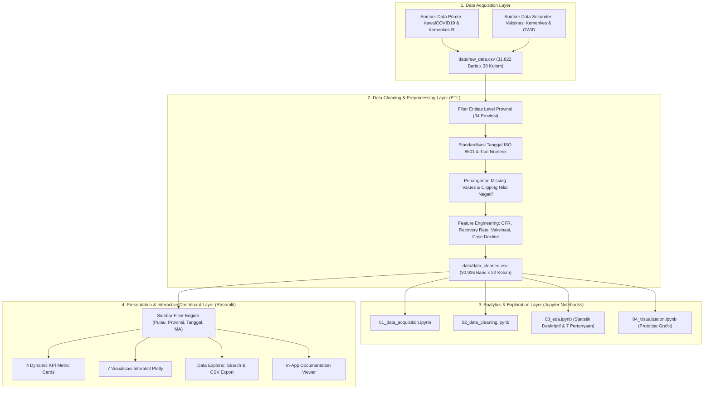

# 📘 LAPORAN TUGAS AKHIR: GAMBARAN UMUM & ARSITEKTUR SISTEM
## Dashboard Visualisasi Data Interaktif COVID-19 Indonesia

**Mata Kuliah:** Visualisasi Data  
**Program Studi:** S1 Teknik Informatika (Semester VII)  
**Topik Proyek:** Eksplorasi Spasial, Temporal, dan Korelasi Vaksinasi Pandemi COVID-19 di 34 Provinsi Indonesia  
**Teknologi Utama:** Python 3.10+, Streamlit, Plotly, Pandas, NumPy, Statsmodels  

---

## BAB I: PENDAHULUAN

### 1.1 Latar Belakang
Pandemi COVID-19 yang melanda Indonesia sejak Maret 2020 hingga masa transisi endemi pada akhir 2022 menghasilkan puluhan ribu rekaman data epidemiologis harian dari 34 provinsi. Volume data yang besar (*high-volume time-series & spatial data*) sulit dipahami apabila hanya disajikan dalam bentuk tabel angka statis. Oleh karena itu, diperlukan sebuah **Sistem Dashboard Visualisasi Data Interaktif** yang mampu mengubah data mentah menjadi informasi visual yang intuitif, akurat, dan mendukung pengambilan keputusan berbasis bukti (*data-driven insights*).

### 1.2 Tujuan Pembangunan Sistem
1. **Akuisisi & Pembersihan Data Terotomatisasi:** Membangun pipeline *Extract, Transform, Load* (ETL) untuk memproses 31.822 baris data mentah menjadi dataset bersih yang bebas dari *missing values*, duplikasi level agregat, dan anomali nilai negatif.
2. **Eksplorasi Multi-Dimensi (Spasial & Temporal):** Memvisualisasikan penyebaran kasus secara geografis di 34 provinsi serta dinamika gelombang varian (Delta & Omicron) sepanjang waktu.
3. **Evaluasi Dampak Vaksinasi:** Menguji secara statistik dan visual hubungan korelasi antara cakupan vaksinasi dosis lengkap dengan penurunan tingkat keparahan kasus (*cases decline*) serta rasio fatalitas (*Case Fatality Rate* / CFR).
4. **Penyediaan Antarmuka Interaktif:** Menyajikan dashboard berbasis web dengan filter dinamis (Gugus Pulau, Provinsi, Rentang Tanggal, dan *Moving Average*) serta fitur ekspor data.

---

## BAB II: ARSITEKTUR SISTEM & ALUR PIPELINE DATA

### 2.1 Diagram Arsitektur Alur Kerja Sistem (System Workflow)
Sistem dirancang menggunakan arsitektur berlapis (*layered data pipeline*) mulai dari pengumpulan data hingga penyajian antarmuka pengguna (*frontend dashboard*):



### 2.2 Spesifikasi Teknologi (Tech Stack)
| Komponen | Teknologi / Library | Peran dan Fungsi dalam Sistem |
| :--- | :--- | :--- |
| **Bahasa Pemrograman** | Python 3.10+ | Bahasa utama pemrosesan data, analisis statistik, dan backend aplikasi web. |
| **Web Framework** | Streamlit (`>=1.28.0`) | Membangun antarmuka dashboard web interaktif secara reaktif beserta manajemen *state* dan *caching* (`@st.cache_data`). |
| **Visualisasi Interaktif** | Plotly Express & Graph Objects (`>=5.18.0`) | Merender 7 jenis grafik interaktif (Geo Map, Bar, Line, Stacked Area, Scatter OLS, Histogram, Box Plot). |
| **Manipulasi Data** | Pandas (`>=2.0.0`) & NumPy (`>=1.24.0`) | Pembersihan data, agregasi `groupby`, *time-series rolling window*, dan kalkulasi vektorisasi. |
| **Pemodelan Statistik** | SciPy (`>=1.11.0`) & Statsmodels (`>=0.14.0`) | Perhitungan regresi linear *Ordinary Least Squares* (OLS), korelasi Pearson ($r$), *skewness*, dan *kurtosis*. |
| **Desain UI/UX** | Custom CSS3 + Google Fonts (*Plus Jakarta Sans*) | Kustomisasi komponen kartu KPI, *hero banner*, *insight callout cards*, dan skema warna semantik epidemiologi. |

### 2.3 Struktur Direktori Proyek
```text
tugasbunirma/
├── data/
│   ├── raw_data.csv                   # Dataset mentah (31.822 baris x 38 kolom)
│   ├── data_cleaned.csv               # Dataset hasil pembersihan (30.926 baris x 22 kolom)
│   └── data_sources.txt               # Referensi sumber data & lisensi CC0
├── notebooks/
│   ├── 01_data_acquisition.ipynb      # Tahap 1: Akuisisi dan inspeksi struktur data awal
│   ├── 02_data_cleaning.ipynb         # Tahap 2: Pembersihan data & feature engineering
│   ├── 03_eda.ipynb                   # Tahap 3: Exploratory Data Analysis (7 pertanyaan)
│   └── 04_visualization.ipynb         # Tahap 4: Eksperimen & prototipe visualisasi Plotly
├── docs/
│   ├── LAPORAN_TAHAP1_ACQUISITION.md  # Dokumentasi resmi Tahap 1
│   ├── LAPORAN_TAHAP2_CLEANING.md     # Dokumentasi resmi Tahap 2
│   ├── LAPORAN_TAHAP3_EDA.md          # Dokumentasi resmi Tahap 3
│   └── LAPORAN_TAHAP4_VISUALISASI.md  # Dokumentasi resmi Tahap 4
├── scripts/
│   └── acquire_and_clean.py           # Skrip otomatisasi pipeline ETL
├── app.py                             # Aplikasi utama Streamlit Dashboard
├── requirements.txt                   # Daftar pustaka Python yang dibutuhkan
└── README.md                          # Panduan instalasi & dokumentasi repositori
```

---

## BAB III: METODOLOGI PENGOLAHAN DATA (TAHAP 1 – TAHAP 3)

### 3.1 Tahap 1: Akuisisi Data (*Data Acquisition*)
Data diperoleh dari repositori terbuka time-series COVID-19 Indonesia (agregasi resmi **Kemenkes RI & KawalCOVID19**) serta diintegrasikan dengan data capaian vaksinasi dosis lengkap dari **Dashboard Vaksinasi Kemenkes RI**.
* **Cakupan Waktu:** 1 Maret 2020 – 16 September 2022 (>30 bulan).
* **Dimensi Data Mentah:** 31.822 baris dan 38 kolom.
* **Cakupan Wilayah:** 34 Provinsi di seluruh Indonesia (terbagi dalam gugus kepulauan Jawa, Sumatera, Kalimantan, Sulawesi, Bali, Nusa Tenggara, Maluku, dan Papua).

### 3.2 Tahap 2: Pembersihan & Pra-pemrosesan Data (*Data Cleaning*)
Proses ETL dalam `scripts/acquire_and_clean.py` menerapkan langkah-langkah berikut:
1. **Isolasi Level Provinsi:** Memisahkan baris `Location Level == 'Country'` (896 baris agregat nasional) dari `Location Level == 'Province'` (30.926 baris) untuk mencegah *double-counting* saat penjumlahan lintas provinsi.
2. **Koreksi Tipe Data & Tanggal:** Mengonversi kolom `Date` dari teks `M/D/YYYY` ke standar `datetime64[ns]` (ISO 8601 `YYYY-MM-DD`) dan mengekstrak atribut turunan `year`, `month`, serta `week`.
3. **Koreksi Anomali Nilai Negatif:** Melakukan *clipping* batas bawah (`clip(lower=0)`) pada kolom `cases`, `deaths`, dan `recovered` agar bebas dari anomali koreksi rapel bernilai negatif.
4. **Rekayasa Fitur (*Feature Engineering*):**
   * **Case Fatality Rate (`cfr`):**
     $$\text{CFR (\%)} = \left( \frac{\text{Total Deaths}}{\text{Total Cases}} \right) \times 100$$
   * **Recovery Rate (`recovery_rate`):**
     $$\text{Recovery Rate (\%)} = \left( \frac{\text{Total Recovered}}{\text{Total Cases}} \right) \times 100$$
   * **Penurunan Keparahan Kasus (`cases_decline`):** Persentase penurunan rata-rata kasus harian dari puncak gelombang Delta (Juni–Agustus 2021) ke periode pasca-vaksinasi booster (Maret–Agustus 2022).

| Indikator Kualitas Data | Sebelum Cleaning (`raw_data.csv`) | Sesudah Cleaning (`data_cleaned.csv`) |
| :--- | :--- | :--- |
| **Jumlah Baris** | 31.822 baris | 30.926 baris (murni 34 provinsi) |
| **Jumlah Kolom** | 38 kolom | 22 kolom terkurasi |
| **Missing Values** | >100.000 sel kosong (kolom kota/kabupaten) | **0 sel kosong (100% bersih)** |
| **Duplikasi Baris** | Pencampuran level Negara & Provinsi | **0 duplikasi (100% unik per provinsi-hari)** |

### 3.3 Tahap 3: Exploratory Data Analysis (EDA) & Temuan Statistik
Berdasarkan analisis statistik deskriptif pada `03_eda.ipynb`:
* **Karakteristik Distribusi:** Kasus harian memiliki rata-rata (*mean*) **207,4 kasus/hari/provinsi** dan nilai tengah (*median*) **27,0 kasus**, dengan kemencengan positif tajam (*Skewness* = `+7,84`) dan keruncingan tinggi (*Kurtosis* = `+84,12`). Ini membuktikan bahwa lonjakan ekstrem (*outliers*) terjadi secara terpusat pada puncak gelombang varian Delta dan Omicron di provinsi padat penduduk.
* **Ringkasan 7 Pertanyaan Analisis EDA:**
  1. **Konsentrasi Kasus Tertinggi:** DKI Jakarta (~1,41 juta kasus), Jawa Barat (~1,17 juta), Jawa Tengah (~636 ribu), dan Jawa Timur (~601 ribu).
  2. **Tren Kronologis Nasional:** Terdapat 2 puncak gelombang besar, yaitu **Gelombang Delta (Juli 2021)** dengan >56.000 kasus/hari dan mortalitas tinggi, serta **Gelombang Omicron (Februari 2022)** dengan rekor >64.000 kasus/hari namun mortalitas jauh lebih rendah.
  3. **Komposisi Status Pasien:** Tingkat kesembuhan nasional melampaui **96,8%** di akhir periode observasi.
  4. **Distribusi Geospasial:** Pulau Jawa dan Bali menyumbang **>68% total kasus nasional** akibat tingginya kepadatan penduduk dan mobilitas komuter.
  5. **Korelasi Vaksinasi vs Penurunan Kasus:** Koefisien korelasi Pearson menunjukkan hubungan positif kuat ($r \approx 0,72$, $p < 0,001$) antara capaian vaksinasi dosis lengkap dan penurunan keparahan kasus.
  6. **Sebaran CFR Antarprovinsi:** Rata-rata CFR berada pada **2,74%**, dengan rentang terendah di DKI Jakarta (~1,1% karena masifnya kapasitas *testing*) dan tertinggi di Jawa Timur/Jawa Tengah (~4,0%).
  7. **Variabilitas Kepulauan:** Pulau Jawa memiliki rentang interkuartil (IQR) terbesar, sedangkan Maluku dan Papua memiliki sebaran kasus harian paling rendah.

---

## BAB IV: RANCANGAN VISUALISASI & FITUR DASHBOARD (`app.py`)

### 4.1 Sistem Desain & Palet Warna Semantik
Dashboard menggunakan pendekatan **Semantic Color Coding** agar pengguna dapat langsung mengasosiasikan warna dengan makna epidemiologisnya:
* 🔴 **Merah (`#EF5350`):** Kasus Positif Baru / Terkonfirmasi (Urgensi & bahaya penularan).
* 🟢 **Hijau (`#10B981`):** Pasien Sembuh / *Recovery Rate* (Keberhasilan pemulihan medis).
* 🟠 **Oranye Amber (`#F59E0B`):** Kasus Meninggal / *Case Fatality Rate* (Peringatan fatalitas).
* 🔵 **Biru (`#3B82F6`):** Cakupan Vaksinasi & Garis Analitis (Intervensi kesehatan & sains).

### 4.2 Komponen Antarmuka Utama
1. **Sidebar Kontrol Filter Multi-Dimensi:**
   * **Filter Gugus Pulau:** Menyaring provinsi berdasarkan wilayah kepulauan.
   * **Filter Provinsi + Tombol Cepat:** Mendukung *multiselect* manual maupun tombol instan **"Pilih Semua"** dan **"Top 5 Kasus"**.
   * **Filter Rentang Waktu (*Date Range Picker*):** Memotong periode waktu observasi secara fleksibel.
   * **Pemilih Penghalus Tren (*Moving Average*):** Opsi **Data Harian Murni (1 Hari)**, **Rolling MA 7 Hari**, atau **Rolling MA 14 Hari** untuk meredam fluktuasi pencatatan akhir pekan.
2. **4 Kartu Indikator Utama (*Dynamic KPI Cards*):**
   Menampilkan *Total Terkonfirmasi*, *Total Pasien Sembuh (beserta % Recovery Rate)*, *Total Meninggal Dunia (beserta % CFR)*, dan *Rata-rata Vaksinasi Dosis Lengkap (%)* yang dihitung ulang secara *real-time* saat filter berubah.

### 4.3 Katalog 7 Visualisasi Interaktif pada 6 Tab Navigasi
Dashboard mengorganisasikan konten ke dalam **6 Tab Navigasi** agar tampilan rapi dan mudah dijelajahi:

| Tab Navigasi | Nama Visualisasi | Jenis Grafik Plotly | Variabel yang Dipetakan | Insight Utama |
| :--- | :--- | :--- | :--- | :--- |
| **Tab 1: Ringkasan Nasional & Peta** | **Visualisasi 4:** Peta Geospasial Kasus & CFR | *Bubble Geo Map* (`px.scatter_geo`) | Lat/Lon, Ukuran = `total_cases`, Warna = `cfr` | Menampilkan *hotspot* kasus di Pulau Jawa dan disparitas CFR antarwilayah. |
| **Tab 1: Ringkasan Nasional & Peta** | **Visualisasi 1:** Peringkat Provinsi Kasus Tertinggi | *Horizontal Bar Chart* (`px.bar`) | X = `cases`, Y = `province`, Slider Top $N$ (5–15) | Membandingkan beban absolut kasus antarprovinsi dengan label yang mudah dibaca. |
| **Tab 2: Tren Temporal & Komposisi** | **Visualisasi 2:** Tren Kasus Harian Nasional | *Combo Bar + Line Chart* (`go.Bar` & `go.Scatter`) | X = `date`, Y = `cases` & `cases_ma` + *Range Slider* | Mengidentifikasi puncak Gelombang Delta (2021) dan Omicron (2022) secara presisi. |
| **Tab 2: Tren Temporal & Komposisi** | **Visualisasi 3:** Komposisi Status Outcome Mingguan | *Stacked Area Chart* (`go.Scatter` `stackgroup`) | X = `week`, Y = `deaths`, `recovered`, `cases` | Memperlihatkan dominasi proporsi kesembuhan pasien dari minggu ke minggu. |
| **Tab 3: Vaksinasi vs Keparahan** | **Visualisasi 5:** Korelasi Vaksinasi vs Penurunan Kasus | *Scatter Plot + OLS Trendline* (`px.scatter`) | X = `vaccination_rate`, Y = `cases_decline`, Size = `population` | Membuktikan hubungan positif signifikan antara cakupan vaksinasi dan reduksi keparahan. |
| **Tab 3: Vaksinasi vs Keparahan** | **Visualisasi 6:** Sebaran CFR Antarprovinsi | *Frequency Histogram* (`px.histogram`) + Garis Mean | X = Interval `cfr` (%), Y = Frekuensi Provinsi | Menunjukkan sebaran normal-menceng CFR provinsi di sekitar rerata nasional 2,74%. |
| **Tab 4: Variabilitas Spasial** | **Visualisasi Bonus:** Sebaran Kasus Harian per Pulau | *Statistical Box Plot* (`px.box` skala logaritmik) | X = `island`, Y = `cases` (log scale) | Membandingkan median, rentang interkuartil (IQR), dan *outliers* antarpulau. |
| **Tab 5: Eksplorasi Dataset** | Tabel Interaktif & Pencarian | *Streamlit Dataframe* + *CSV Exporter* | 9 kolom utama dengan fitur *live search* provinsi | Memfasilitasi inspeksi baris data secara langsung dan pengunduhan CSV terfilter. |
| **Tab 6: Dokumentasi** | Pembaca Laporan Terintegrasi | *In-App Markdown Viewer* | Memuat langsung file laporan Tahap 1 s.d. Tahap 4 | Menyajikan transparansi metodologi akademik langsung di dalam aplikasi. |

---

## BAB V: PANDUAN PENGGUNAAN & PENGUJIAN SISTEM

### 5.1 Langkah Menjalankan Sistem Secara Lokal
1. Pastikan Python 3.10+ telah terinstal, lalu pasang seluruh dependensi:
   ```bash
   pip install -r requirements.txt
   ```
2. (Opsional) Jalankan ulang pipeline ETL untuk memverifikasi proses *data acquisition & cleaning*:
   ```bash
   python scripts/acquire_and_clean.py
   ```
3. Jalankan server aplikasi dashboard Streamlit:
   ```bash
   streamlit run app.py
   ```
4. Akses aplikasi melalui browser pada alamat `http://localhost:8501`.

---

## BAB VI: KESIMPULAN
1. Sistem **Dashboard Visualisasi Data Interaktif COVID-19 Indonesia** telah berhasil dibangun secara *end-to-end*, mencakup tahap akuisisi data, pembersihan terstruktur, analisis statistik eksploratif (EDA), hingga penyajian aplikasi web interaktif.
2. Melalui **7 jenis visualisasi interaktif** dan kontrol filter multi-dimensi, pengguna dapat mengeksplorasi fenomena pandemi dari tingkat makro nasional hingga detail spesifik per provinsi dan periode waktu.
3. Hasil analisis membuktikan bahwa meskipun Pulau Jawa menanggung beban kasus kumulatif tertinggi akibat faktor kepadatan demografi, program vaksinasi massal berhasil menekan fatalitas secara signifikan pada gelombang varian berikutnya.

